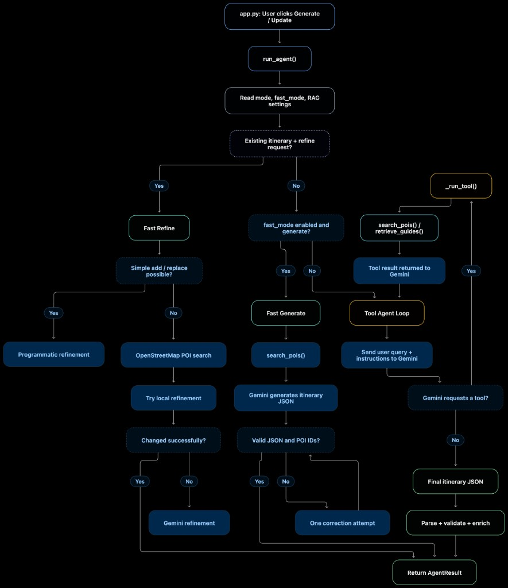
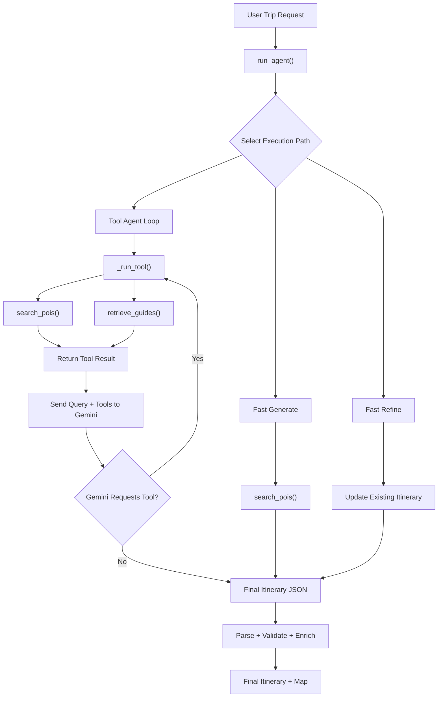
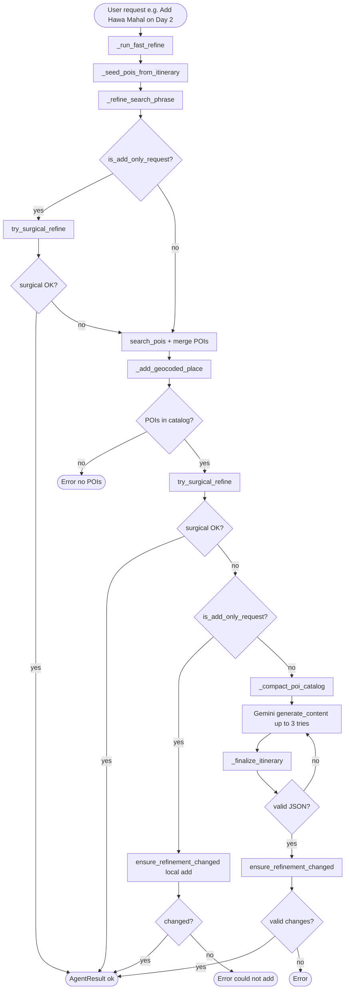
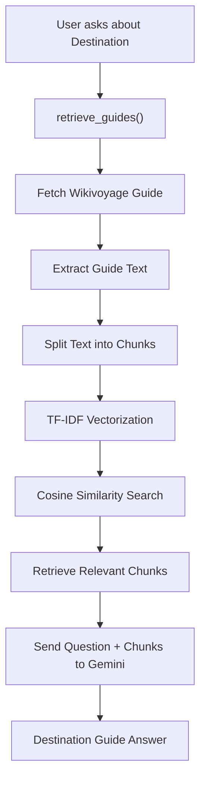
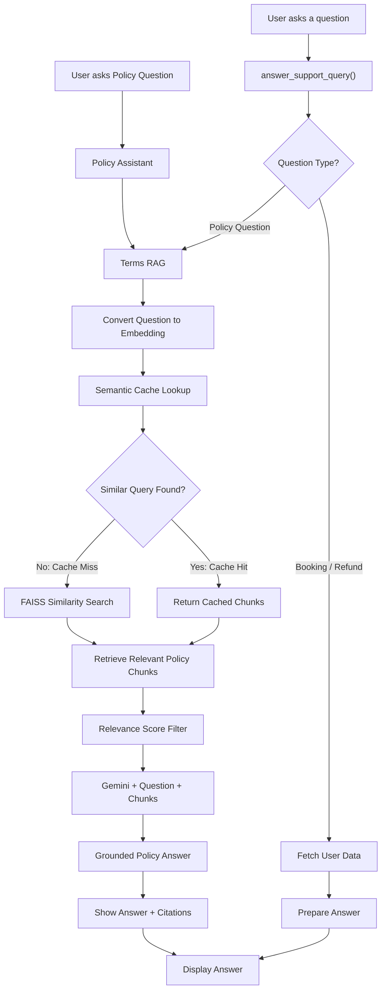
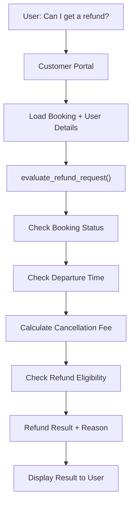
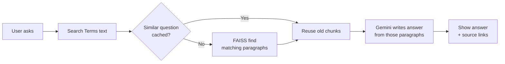
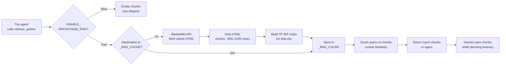

Three things which is not persist in the app_state.json

1. Chat history
2. Chunks
3. Votes

**pytest** is a popular third-party Python testing framework that simplifies writing and executing these tests.

# Application flows

Developer docs (`/dev`) show architecture flowcharts (PNG + fullscreen). Trip and Destination first; merged Terms/policy hub; portal refund; plus the two RAG pipeline charts below.

| Flow                                                    | Retrieval                                          | Gemini                 |
| ------------------------------------------------------- | -------------------------------------------------- | ---------------------- |
| Trip Planner Agent                                      | POI tools + optional RAG                           | Yes                    |
| Destination Guide                                       | TF-IDF + cosine similarity                         | Yes                    |
| Terms & policy retrieval (merged hub)                   | Policy Assistant + Support policy + Semantic cache | FAISS + cache + Gemini |
| Customer Portal → Refund                                | Python rule engine                                 | No                     |
| 1) Policy / Terms RAG (Support bot, Document Assistant) | Terms FAISS + semantic cache                       | Yes                    |
| 2) Wikivoyage TF-IDF RAG (`wikivoyage_rag.py`)          | sklearn TF-IDF + cosine (agent tool)               | Yes (itinerary)        |

## Trip Planner Agent

### Trip routing (`run_agent`)

Entry in `services/trip/agent.py`. Refine paths delegate to `_run_fast_refine` (detail below). Fast generate can fall through to the tool loop on soft failure (not geocoding/Overpass hard errors).

## Place refinement (`_run_fast_refine`)

Refine and single-day edits (`services/trip/agent.py`, `refine_itinerary.py`): seed POIs from the current itinerary, try a local surgical add when possible, enrich the catalog via OSM/geocode, then Gemini only if nee**ded.**

## Destination Guide(Retrival 1) Wikivoyage

## Terms & policy retrieval (Retrival 2) Semantic Caching

Policy Assistant, Help & Support (policy path), and Semantic retrieval cache share **Terms RAG → cache → FAISS → Gemini**; Support **booking/refund** branch uses live data (no FAISS).

## Customer Portal → Refund (Rule Based)

Separate rule engine — not merged with Terms / FAISS hub.

## 1) Policy / Terms RAG (Support bot, Document Assistant)

Support bot (policy path), Document Assistant chat, and Trip policy FAB share **Terms FAISS + optional semantic cache + Gemini**. Booking/refund shortcuts in Support use live portal data without FAISS.

## 2) Wikivoyage TF-IDF RAG (`wikivoyage_rag.py`)

Optional trip agent tool only (`retrieve_guides`). **sklearn TF-IDF + cosine** — not FAISS. Off unless `ENABLE_WIKIVOYAGE_RAG=true`.

---

`streamlit run app.py` · `README.md` · `SETUP.md` · `info.md`