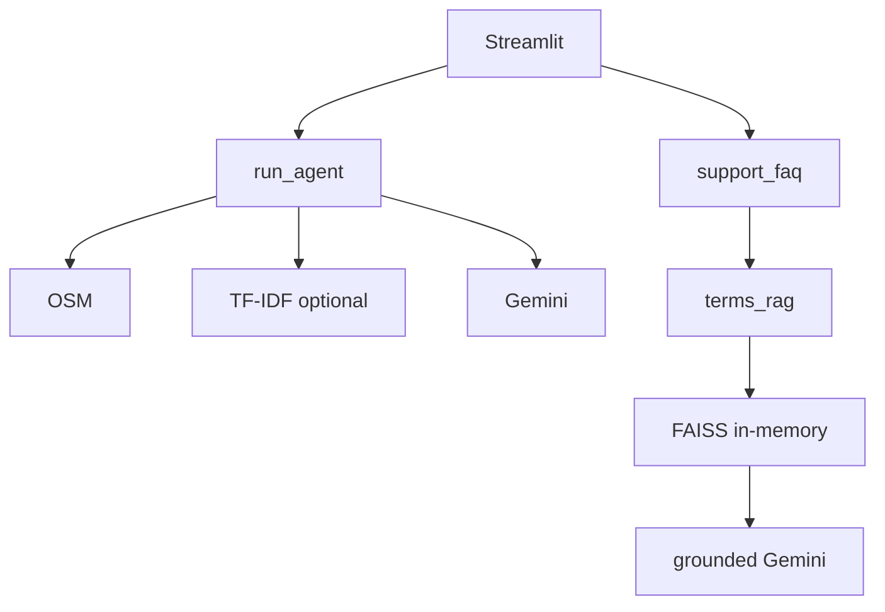

# ARCHITECTURE.md — as implemented

Multi-page **Streamlit** app combining Gemini trip agent, **LangChain + in-memory FAISS** policy RAG, optional **Wikivoyage TF-IDF**, OSM/PyDeck, JSON persistence. Unverified items marked **unknown**.

## Overview

| Concern | Implementation |
|---------|----------------|
| Trip planning | `google-genai` tool loop — `services/agent.py` |
| Policy Q&A | LangChain split/embed/FAISS + Gemini answers — `website_rag.py` |
| Destination context (optional) | Wikivoyage + TF-IDF — `wikivoyage_rag.py` |
| Demo portal | JSON under `data/` |

**One** LangChain FAISS pipeline; trip agent does **not** use LangChain for generation.

## Stack (`requirements.txt` mins)

Streamlit, `extra-streamlit-components`, `google-genai`, dotenv, pydeck, requests, sklearn, numpy/pandas, langchain-core/community/google-genai/text-splitters, **faiss-cpu**.

**Models (`config.py`):** chat `gemini-3.5-flash-lite` + fallbacks; embedding candidates + `GEMINI_EMBEDDING_MODEL`; `EMBEDDING_CACHE_VERSION=4`.

**Streamlit:** `.streamlit/config.toml` — light theme, headless, static serving.

## Layout

```
app.py, config.py, pages/, services/, data/, tests/, app/static/
```

**Pages:** `dev`, `bookings_refunds`, `refund_assistant`, `terms_policies`, `account_status`, `support`, `sign_in`, `admin_demo`.

**Key services:** `agent`, `website_rag`, `terms_rag`, `support_faq`, `policy_bot_ui`, `wikivoyage_rag`, `poi_search`/`geocoding`, `persistence`, `customer_portal_store`, `rag_chat_auth`, `feedback`, refunds/bookings, `portal_ui`, UI/map/trace modules.

## Runtime (`app.main`)

1. Page config wide  
2. RAG auth cookie + session + portal sync  
3. UI inject + dashboard switch  
4. `st.navigation` → `pg.run()`  
5. Global sidebar every run  

**Model:** full rerun on widgets; long work in handlers.

## FAISS policy pipeline

**Corpus:** `terms_content.py`, `FAQ_ITEMS`, `POLICIES` → `Document` → strip markdown → split **1100/180** (`RecursiveCharacterTextSplitter`).

**Optional URL:** `WebBaseLoader` 20s; ≥40 chars; same splitter; **chat answers still use Terms index**.

**Embed:** `GoogleGenerativeAIEmbeddings`, probe `healthcheck`, `@st.cache_resource`.

**Index:** `FAISS.from_documents` in memory — **no disk `.faiss`**.

**Retrieve:** `similarity_search_with_score`, score `1/(1+d)`, filter **MIN_RELEVANCE_SCORE 0.42**, `top_k` 3–4.

**Answer:** `generate_grounded_answer` — Gemini + `GROUNDED_SYSTEM_INSTRUCTION`; chunk markdown fallback.

**UI path:** `policy_bot_ui` → `answer_support_query` → `answer_from_terms_document` → retrieve + generate. History in `policy_bot_messages_*` (session only).

**Gap:** `rag_chat_ui.render_page_menu` not on any route.

## Trip agent (not FAISS)

Form → `validate_trip_inputs` → `run_agent` → `search_pois` (OSM + feedback boosts) → optional `retrieve_guides` (Wikivoyage if enabled & not fast mode) → Gemini JSON → validate/enrich → UI + `app_state.json`.

Fast mode default; `FAST_MODE_MAX_STEPS=4`. Tools via `google.genai` function calling, not LangChain agents.

## Wikivoyage (orthogonal)

MediaWiki → chunk 800–1000 → TF-IDF cosine; module `_RAG_CACHE`; not FAISS.

## Env & paths

Required: `GEMINI_API_KEY`, `OSM_CONTACT_EMAIL`. Optional: embed override, `ENABLE_WIKIVOYAGE_RAG`, `DESTINATION_GUIDE_AI`.

**Data:** see `DATABASE.md` — `app_state`, feedback, demo bookings, portal state, RAG auth JSON.

## Session vs persistence

| Data | Where |
|------|--------|
| Itinerary/forms | session + `app_state.json` |
| Policy chat | session only |
| FAISS/embeddings | `@st.cache_resource` |
| Portal | `customer_portal_store` |
| Auth | JSON + cookie |

## External HTTP

Gemini (SDK); Nominatim/Overpass (User-Agent); Wikivoyage; Wikipedia/weather; optional URL GET. Resilience: `http_client` 15s, 2 retries, Nominatim 1 req/s; agent `retry_utils`.

## Errors

Broad `except` + user strings; RAG layered fallbacks; corrupt JSON → empty defaults.

## Tests

`test_terms_rag` (FakeEmbeddings FAISS), `test_rag_citations`, `test_refund_eligibility`, `test_validation`, others — **CI unknown**.

## Known debt (code-verified)

Dual retrieval stacks; narrow LangChain scope; URL FAISS unused in chat; Document Assistant UI gap; volatile in-memory FAISS; demo auth; `get_openai_api_key` alias; Refund Assistant = rules not FAISS; distance metric comment vs L2 heuristic.



*Re-verify after substantive code changes.*
