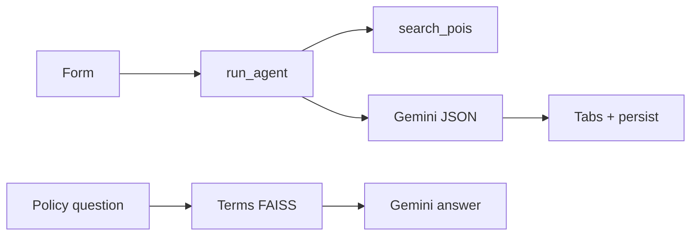

# Trip Planner — Project guide (`info.md`)

**Run:** `streamlit run app.py` · **In browser:** [http://localhost:8501/dev](http://localhost:8501/dev) (Developer docs)

## 1. 30-second summary

| | |
|--|--|
| **App** | Multi-day **Trip Planner** + simulated **customer portal** (bookings, refunds, support, admin). |
| **UI** | Streamlit multipage; itinerary / map / travel tabs. |
| **AI** | **Gemini** builds JSON itineraries; every `poi_id` must exist in OSM catalog first. |
| **Places** | Nominatim + Overpass. |
| **Policy Q&A** | **LangChain + FAISS + Gemini** on in-app terms (`website_rag.py`) — separate from trip agent. |
| **Refunds** | `refund_eligibility.py` — UI/bots must not override. |
| **Data** | `app_state.json`, `feedback.jsonl`, `demo_bookings.json`, `customer_portal_state.json`, RAG auth JSON. |

**Golden rule:** Model **must not invent places** — all stops reference `tool_state.pois`.

## 2. User story (short)

Form → **Create my itinerary** → geocode + POI search + Gemini arranges morning/afternoon/evening → map + travel tab → optional single-day edit, nearby swap (no AI), 👍/👎 → sidebar trip history.

## 3. Flow (high level)



## 4. Code map

```
app.py, config.py, pages/, services/, data/, tests/, docs/*.md, README.md
```

**`app.py`:** `main`, `_init_session`, `_run_generation`, `_render_itinerary`, map/travel, `_flush_persist`.

**Planner services:** `agent`, `poi_search`, `geocoding`, `validation`, `refine_itinerary`, `feedback`, `persistence`, `trip_history`, `travel_hints`, `destination_guide`, `weather`, `map_viz`, `nearby_pois`, `wikivoyage_rag`, `website_rag`, `terms_rag`, `support_faq`, `policy_bot_ui`, `http_client`, `retry_utils`, UI/trace modules.

**Portal:** `pages/bookings_refunds`, `refund_assistant`, `support`, `terms_policies`, `account_status`, `admin_demo`, `sign_in`, `dev`; `customer_portal_store`, `bookings`, `travel_packages`, `package_booking_ui`, `refund_eligibility`, `refund_policy_config`, `portal_ui`, `role_dashboard`, `admin_console`, `demo_dashboard`, `demo_users`, `rag_chat_auth`.

## 5. Streamlit rerun model

Every interaction reruns the script → state in `st.session_state` + disk flush when dirty. Bootstrap loads `app_state.json` once per session.

## 6. Agent flow

1. `validate_trip_inputs`  
2. `run_agent` — default **fast generate:** OSM POIs (+ feedback boosts) → Gemini JSON.  
3. Fallback **tool loop:** `search_pois`, optional `retrieve_guides` (Wikivoyage TF-IDF if enabled & not fast mode).  
4. `_finalize_itinerary` — parse JSON, validate `poi_id`s, enrich photos/hints.  
5. Append trip history on successful **generate**; persist `tool_state` with POIs (and Wikivoyage chunks if any).

Modes: `generate`, `refine`, `single_day` — UI only wires generate + single_day.

## 7. POI search

`geocode_city` (Nominatim) → Overpass query by interests → rank/score → catalog in `tool_state.pois`. User-Agent from `OSM_CONTACT_EMAIL`.

## 8. Validation

Form: destination, interests, days 1–14, pace enum. Itinerary: JSON structure, valid `poi_id`s, single-day leaves other days unchanged (`verify_single_day_unchanged`).

## 9. Single-day & nearby swap

**Single-day:** `_run_fast_refine` with day + user text. **Swap:** pick alternate from catalog within ~5.5 km — local mutation, no Gemini.

## 10. Feedback

👍/👎 → `feedback.jsonl` (`city_key`, `poi_id`) → boosts on next `search_pois` for that city.

## 11. Travel tab

Open-Meteo weather; destination guide (optional Gemini if `DESTINATION_GUIDE_AI`); OSM hints (hotels, airports, transit links); place images.

## 12. Optional Wikivoyage RAG

`ENABLE_WIKIVOYAGE_RAG=true` + non-fast agent path → TF-IDF chunks in tool — **not** policy FAISS.

## 13. Data & memory

| File | Holds |
|------|--------|
| `app_state.json` | Itinerary, forms, `tool_state`, trace tail, `trip_history` |
| `feedback.jsonl` | POI votes |
| `demo_bookings.json` | Static catalog |
| `customer_portal_state.json` | Refunds, tickets, packages, appeals, audit, overrides |
| RAG auth JSON | Local sign-in accounts/sessions |

Policy **FAISS index:** in-process only (`@st.cache_resource`), rebuilt after restart.

## 14. Itinerary JSON shape

```json
{
 "destination": "Goa",
  "days": [{
 "day": 1,
    "morning": [{ "poi_id": "…", "name": "…", "why": "…" }],
 "afternoon": [],
 "evening": []
  }]
}
```

Enrichment may add `lat`, `lon`, `category`, `url`, `image_url`.

## 15. Config & APIs

Setup: venv → `pip install -r requirements.txt` → `.env` → `streamlit run app.py`.

| Env | Required | Purpose |
|-----|----------|---------|
| `GEMINI_API_KEY` | Yes | Trip + embeddings + RAG answers |
| `OSM_CONTACT_EMAIL` | Yes | OSM User-Agent |
| `ENABLE_WIKIVOYAGE_RAG` | No | Agent tool |

Notable `config.py`: `DEFAULT_MODEL`, `FAST_POI_LIMIT` 45, vote boosts ±0.25/0.35, portal paths.

External: Gemini (key); OSM (email); Wikivoyage; Open-Meteo; Wikipedia.

## 16. Errors & retries

Gemini: `retry_utils` on transient errors; model fallbacks; JSON re-prompt on parse fail. OSM hard fail → user error, no fake itinerary. User sees `last_error`; Export may show raw model text. **Agent trace** lists tool steps/timing.

## 17. Navigation & roles

`st.navigation` groups depend on **User vs Admin** dashboard (`demo_dashboard.py`). Portal pages use `portal_page_setup` + context strip + profile dock. Admin mode blocks customer refund submit; package booking uses sidebar-selected user.

## 18. Customer portal

Demo users in sidebar; bookings merge catalog + `BK-PKG-*` user packages; refunds create `RR-*` workflow rows; tickets with threads; account restrictions/appeals — all in `customer_portal_state.json`.

## 19. Refund rule engine

`evaluate_refund_request(booking, user_id, account_status, …)` → eligibility, fees, estimated refund, next steps. **Refund Assistant** and booking forms must use this — not LLM override.

## 20. Travel packages

Catalog in `travel_packages.py`; UI in `package_booking_ui.py`; confirm writes package booking to portal state (no payment).

## 21. Support & policy bots

`support_faq.answer_support_query`: keyword/live demo data branches + **terms FAISS** (`answer_from_terms_document`). Shared UI: `policy_bot_ui` (Support page, Trip FAB/sidebar). URL scrape test validates external pages; **answers still from Terms index**.

## 22. Admin console

Passphrase **`demo_admin`** (or Admin dashboard unlock); tabs refunds/tickets/accounts/audit; mutates portal JSON + audit log.

## 23. Glossary

| Term | Meaning |
|------|---------|
| **POI / poi_id** | OSM place / stable id in catalog |
| **tool_state** | Agent+UI shared POIs (and optional chunks) |
| **Fast mode** | Fewer steps; default from app |
| **Tool loop** | Gemini calls OSM/Wikivoyage tools |
| **Terms RAG** | FAISS over terms/FAQ/policies |
| **Wikivoyage RAG** | TF-IDF guide chunks for agent tool |
| **city_key** | Feedback scope for ranking |
| **Portal state** | `customer_portal_state.json` |
| **Catalog vs package booking** | `demo_bookings.json` vs user `BK-PKG-*` |
| **Rule engine** | `refund_eligibility.py` |
| **Session rerun** | Streamlit full script rerun |

## Credits

OpenStreetMap, Wikivoyage, Google Gemini, Open-Meteo, Wikipedia.

*Update this file when features change; detailed specs also in `PRD.md`, `ARCHITECTURE.md`, `API.md`, `DATABASE.md`.*
