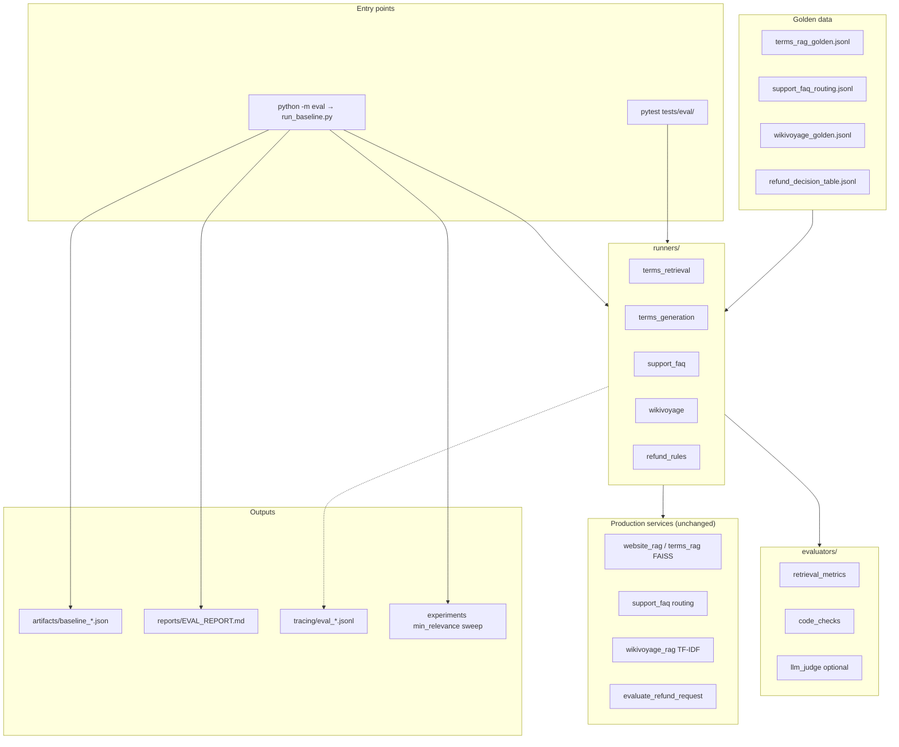

# Travel Planner — Evaluation Report

_Generated: 2026-11-02T09:33:42.980664+00:00_

## Status legend
- **Passed** / **Failed** — automated eval result
- **Requires API credentials** — set `EVAL_LIVE=1` and `GEMINI_API_KEY` for live embed/judge
- **Requires human review** — complex policy interpretation

## 1. Architecture (verified)
Separate stacks: Terms FAISS+Gemini, Support FAQ rules+RAG, Wikivoyage TF-IDF, URL FAISS (optional), Refund rules engine.

### High-level eval flow

## 2. Terms / Policy RAG — retrieval (FakeEmbeddings CI)
- Cases: 28
- Hit@1: 0.1111
- Hit@3: 0.2963
- Recall@3: 0.2222
- MRR: 0.2368
- Avg top-1 score: 0.0015
- Low-confidence %: 1.0
- Escalation accuracy: 0.037

## 3. Terms / Policy RAG — generation (markdown fallback, no Gemini)
- Pass rate: 0.0357 (1/28)

## 4. Support FAQ routing
- Routing accuracy: 0.9333
- Pass rate: 0.6667

## 5. Wikivoyage RAG
- Mode: mocked_wikivoyage_html
- Pass rate: 0.875

## 6. URL scrape RAG (optional)
- Pass rate: 1.0
- Used in production chat: **No** (`retrieve_from_url` not wired to UI chat)

## 7. Refund rules engine
- Pass rate: 1.0

## 8. Threshold experiment (eval harness)
See artifact JSON `experiments.min_relevance_sweep`.

## 9. LLM-as-Judge
**Not tested** in baseline (requires `EVAL_LIVE=1`). Prompt: `eval/evaluators/llm_judge.py`.

## 10. Live Gemini embeddings
**Not tested** in default baseline — FakeEmbeddings used. Run with `EVAL_LIVE=1` for real embed quality (future runner flag).

Full JSON artifact: `eval/artifacts/baseline_20261102T093342Z.json`

## Failure analysis
Inspect `eval/artifacts/baseline_*.json` `details.*_rows` where `pass` is false.