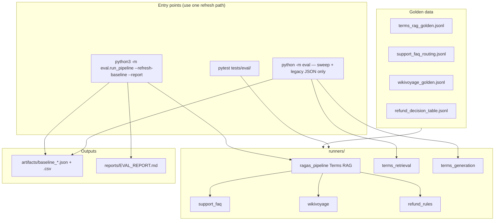

# Travel Planner — Evaluation Report

_Generated: 2026-11-12T10:56:54.616198+00:00_
_Source: `eval.run_pipeline` · `evaluation_mode`: **heuristic_offline**_

## Status legend
- **Passed** / **Failed** — automated eval result
- **Requires API credentials** — set `EVAL_LIVE=1` and `GEMINI_API_KEY` for live embed/judge
- **Requires human review** — complex policy interpretation

## 1. Architecture (verified)
Separate stacks: Terms FAISS+Gemini, Support FAQ rules+RAG, Wikivoyage TF-IDF, Refund rules engine.

### High-level eval flow

## 2. Terms / Policy RAG (pipeline — retrieval + generation)
- Retrieval profile: **hybrid_rerank_v1** (hybrid=True)
- Embedding (eval): HuggingFace:sentence-transformers/all-MiniLM-L6-v2
- Cases: 40 · passed: 38/40 (rate 0.95)
- MRR: 0.7311
- Hit@3: 0.8684
- NDCG@3: 0.7348
- Answer correctness (mean): 0.8712
- Context utilization (mean): 0.8917
- Groundedness (mean): 0.8083
- Hallucination rate (mean): 0.1917

### Ragas-aligned means (offline mapping unless `EVAL_LIVE` + ragas)
- Faithfulness: 0.8083
- Answer relevance: 0.8712
- Context precision: 0.8917
- Context recall: 0.6842

## 3. Support FAQ routing
- Routing accuracy: 0.9615
- Pass rate: 0.8846 (23/26)

## 4. Wikivoyage RAG
- Mode: mocked_wikivoyage_html
- Pass rate: 0.9375 (15/16)

## 5. Refund rules engine
- Pass rate: 1.0 (16/16)

## 6. Threshold experiment (legacy baseline only)
Run `python3 -m eval` (`run_baseline.py`) for `experiments.min_relevance_sweep` in a separate JSON artifact.

## 7. LLM-as-Judge / official Ragas
- `official_ragas_requested`: False
- Live: `EVAL_LIVE=1`, `pip install -r eval/requirements-eval.txt`, optional `EVAL_RAGAS=0` for judge-only.

## 8. Production vs eval embeddings
Eval defaults to HuggingFace MiniLM; production Terms path uses Gemini embeddings unless `EVAL_EMBEDDINGS=gemini`.

Full JSON artifact: `eval/artifacts/baseline_20261112T105743Z.json`

## Failure analysis
- Failed Terms cases: T-R25, T-R40
- Inspect per-case `failure_analysis` in the JSON artifact.
- Per-case detail: `cases.terms_rag[]` in the artifact JSON.