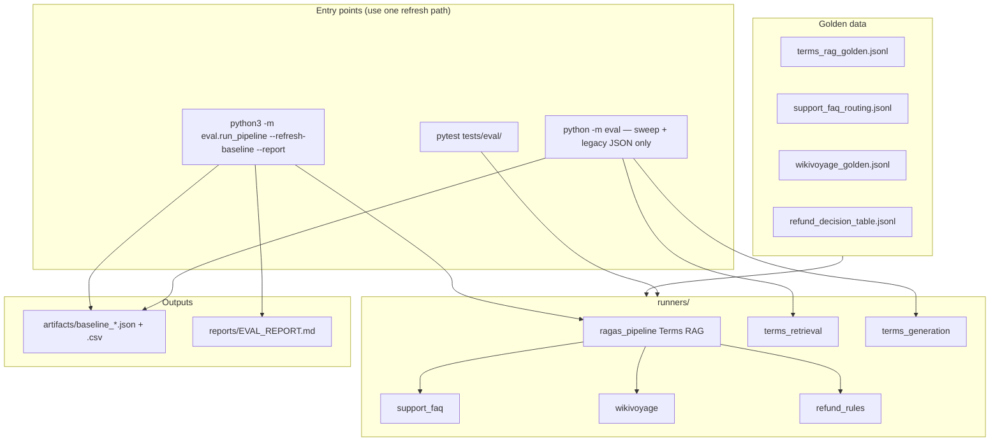
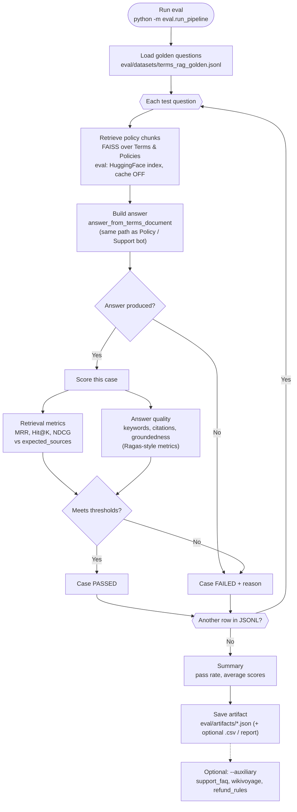
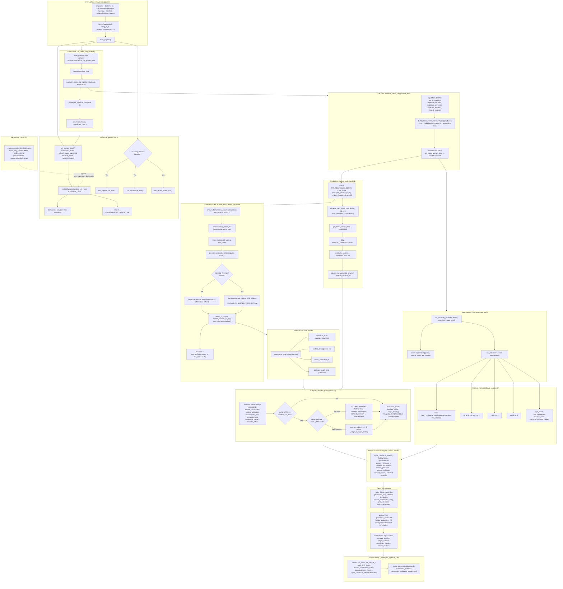

# Travel Planner — Evaluation Report

_Generated: 2026-11-12T10:56:54.616198+00:00_
_Source: `eval.run_pipeline` · `evaluation_mode`: **heuristic_offline**_

## Status legend
- **Passed** / **Failed** — automated eval result
- **Requires API credentials** — set `EVAL_LIVE=1` and `GEMINI_API_KEY` for live embed/judge
- **Requires human review** — complex policy interpretation

## 1. Architecture (verified)
Separate stacks: Terms FAISS+Gemini, Support FAQ rules+RAG, Wikivoyage TF-IDF, Refund rules engine.

### High-level eval flow

## 2. Terms / Policy RAG (pipeline — retrieval + generation)
- Retrieval profile: **hybrid_rerank_v1** (hybrid=True)
- Embedding (eval): HuggingFace:sentence-transformers/all-MiniLM-L6-v2
- Cases: 40 · passed: 38/40 (rate 0.95)
- MRR: 0.7311
- Hit@3: 0.8684
- NDCG@3: 0.7348
- Answer correctness (mean): 0.8712
- Context utilization (mean): 0.8917
- Groundedness (mean): 0.8083
- Hallucination rate (mean): 0.1917

### Ragas-aligned means (offline mapping unless `EVAL_LIVE` + ragas)
- Faithfulness: 0.8083
- Answer relevance: 0.8712
- Context precision: 0.8917
- Context recall: 0.6842

## 3. Support FAQ routing
- Routing accuracy: 0.9615
- Pass rate: 0.8846 (23/26)

## 4. Wikivoyage RAG
- Mode: mocked_wikivoyage_html
- Pass rate: 0.9375 (15/16)

## 5. Refund rules engine
- Pass rate: 1.0 (16/16)

## 6. Threshold experiment (legacy baseline only)
Run `python3 -m eval` (`run_baseline.py`) for `experiments.min_relevance_sweep` in a separate JSON artifact.

## 7. LLM-as-Judge / official Ragas
- `official_ragas_requested`: False
- Live: `EVAL_LIVE=1`, `pip install -r eval/requirements-eval.txt`, optional `EVAL_RAGAS=0` for judge-only.

## 8. Production vs eval embeddings
Eval defaults to HuggingFace MiniLM; production Terms path uses Gemini embeddings unless `EVAL_EMBEDDINGS=gemini`.

Full JSON artifact: `eval/artifacts/baseline_20261112T105743Z.json`

## Failure analysis
- Failed Terms cases: T-R25, T-R40
- Inspect per-case `failure_analysis` in the JSON artifact.
- Per-case detail: `cases.terms_rag[]` in the artifact JSON.

## Appendix — Terms RAG pipeline (per golden case)

Run: `python -m eval.run_pipeline` (default dataset: `eval/datasets/terms_rag_golden.jsonl`).
Each JSONL row runs retrieve → answer → score → pass/fail; summary and artifact are written once after all rows.
Add `--auxiliary` to include Support FAQ, Wikivoyage, and Refund evals in the same artifact (not in this loop).

## Appendix — `eval/artifacts/` files (reference)

New runs add timestamped `evaluation_run_*.json` or `baseline_*.json` (often gitignored).
Look for Ragas eval under `summary.terms_rag_pipeline` / `cases.terms_rag`;
Support / Wikivoyage / Refund under `summary.support_faq`, `summary.wikivoyage`, `summary.refund_rules`.

| File | Source / type | What's inside |
|------|----------------|---------------|
| **`baseline_20261112T105743Z.json`** | `run_pipeline --refresh-baseline` | **All four:** Ragas Terms RAG (`cases.terms_rag[]`) + support_faq + wikivoyage + refund summaries |
| **`baseline_20261112T092643Z.json`** | Full baseline run | Same — Ragas pipeline + support + wikivoyage + refund |
| **`evaluation_run_real_embeddings.json`** | `run_pipeline` (no `--auxiliary`) | **Ragas / Terms only** — no support / wikivoyage / refund |
| **`baseline_20261112T092947Z.json`** | Legacy `run_baseline.py` | **Not Ragas:** `terms_retrieval` + `terms_generation`, support, wikivoyage, refund, `min_relevance_sweep` |
| **`baseline_20261112T105743Z.csv`** | Companion to `105743Z.json` | **One row** — Terms RAG / Ragas means only (MRR, Hit@3, faithfulness, pass_rate, …) |

## Appendix — RAGAS pipeline architecture (detailed)

Code path: `eval/run_pipeline.py` → `eval/runners/ragas_pipeline.py`.
Diagram source: `eval/reports/ragas_pipeline_architecture.mmd`.

## Appendix — Auxiliary eval workflows (Support, Wikivoyage, Refund)

Triggered by `python -m eval.run_pipeline --auxiliary`, `run_baseline.py`, or `pytest tests/eval/`.
Bundled into the same artifact as Terms RAG when `--auxiliary` or `--refresh-baseline` is used.

### 1. `support_faq_routing.jsonl` → `run_support_faq_eval()`

**Runner:** `eval/runners/support_faq.py`

| Step | What happens |
|------|----------------|
| 1 | Load row: `user_id`, `message`, `expected_route`, `expect_escalate` |
| 2 | Patch `answer_from_terms_document` to count RAG calls and run real Terms RAG with eval FAISS (HuggingFace) |
| 3 | Call production `answer_support_query(user_id, message)` (greeting, account, refund status, booking BK-…, or terms RAG) |
| 4 | `_classify_route` on message + reply + RAG call count → `actual_route` (e.g. `terms_rag`, `booking_lookup`) |
| 5 | Compare `actual_route` to `expected_route` (small relaxations for `terms_rag` / `no_match_or_loose`) |
| 6 | Escalation: for most routes, `escalate` must match `expect_escalate`; greeting/empty/booking/refund_status → routing only |
| 7 | Aggregate: `routing_accuracy`, `pass_rate` |

**Pass** = correct branch (+ escalation when required). Does **not** grade answer text quality.

### 2. `wikivoyage_golden.jsonl` → `run_wikivoyage_eval()`

**Runner:** `eval/runners/wikivoyage.py` · Default mode: **`mocked_wikivoyage_html`** (no real HTTP).

| Step | What happens |
|------|----------------|
| 1 | Load row: `destination`, `query`, `expected_keywords`, `min_chunks`, `expect_ok`, … |
| 2 | Clear `_RAG_CACHE` |
| 3 | Patch `_fetch_wikivoyage_article` → fake HTML for that city (or `None` for bad titles) |
| 4 | `retrieve_guides(..., enabled=True)` → TF-IDF build/search → chunks + scores |
| 5 | `retrieve_guides(..., enabled=False)` → must return **no chunks** |
| 6 | Check: `ok`, chunk count ≥ `min_chunks`, keywords appear in chunk text (or destination) |
| 7 | Aggregate: `pass_rate`, `mode: mocked_wikivoyage_html` |

Optional: `EVAL_LIVE=1` + `live_network=True` → real API; logs `ok` + chunk count only.

**Pass** = retrieval behaves when RAG is on and off; optional keyword/chunk checks.

### 3. `refund_decision_table.jsonl` → `run_refund_rules_eval()`

**Runner:** `eval/runners/refund_rules.py` · **No RAG, no LLM.**

| Step | What happens |
|------|----------------|
| 1 | Load row: `booking_id`, `user_id`, `now`, `account_status`, `reason`, `expected_eligibility`, optional refund bounds |
| 2 | `get_booking(booking_id)` from demo portal data |
| 3 | If missing → pass only if case expects `missing_booking` error |
| 4 | `evaluate_refund_request(...)` — pure rules (policy, timing, fees) |
| 5 | Compare `ev.eligibility` to `expected_eligibility`; optional min/max `estimated_refund` |
| 6 | Aggregate: `pass_rate` |

**Pass** = rule engine output matches the golden row.
