# Trip Planner — Complete Project Guide ([info.md](http://info.md))

> **What this file is for:** Read this to learn what the app does, how the code flows, where data is saved, and how AI and OpenStreetMap fit in. 
> **How to run the app:** From the project folder, run `streamlit run app.py` 
> **Developer docs in the browser:** Open [http://localhost:8501/dev](http://localhost:8501/dev) (sidebar link: **Developer docs**)

---

## Table of contents

1. [30-second summary](#1-30-second-summary)
2. [Simple story — from the user’s view](#2-simple-story--from-the-users-view)
3. [Big picture flowchart](#3-big-picture-flowchart)
4. [Code map — which file does what](#4-code-map--which-file-does-what)
5. [Streamlit app flow (](#5-streamlit-app-flow-apppy)`app.py`[)](#5-streamlit-app-flow-apppy)
6. [Agent flow — how the itinerary is built](#6-agent-flow--how-the-itinerary-is-built)
7. [POI search flow (OpenStreetMap)](#7-poi-search-flow-openstreetmap)
8. [Validation flow](#8-validation-flow)
9. [Single-day update and nearby swap](#9-single-day-update-and-nearby-swap)
10. [Feedback loop](#10-feedback-loop)
11. [Travel tab extras (weather, guide, hotels)](#11-travel-tab-extras-weather-guide-hotels)
12. [Optional Wikivoyage RAG](#12-optional-wikivoyage-rag)
13. [Data files and memory](#13-data-files-and-memory)
14. [Itinerary JSON shape](#14-itinerary-json-shape)
15. [Config and APIs](#15-config-and-apis)
16. [Errors and retries](#16-errors-and-retries)
17. [Multi-page navigation and roles](#17-multi-page-navigation-and-roles)
18. [Customer portal architecture](#18-customer-portal-architecture)
19. [Refund rule engine](#19-refund-rule-engine)
20. [Travel package booking](#20-travel-package-booking)
21. [Support, tickets, and policy bots](#21-support-tickets-and-policy-bots)
22. [Admin console](#22-admin-console)
23. [Glossary](#23-glossary)

---


## 1. 30-second summary


| Question                 | Answer                                                                                                                                                            |
| ------------------------ | ----------------------------------------------------------------------------------------------------------------------------------------------------------------- |
| **What is this app?**    | A multi-day **Trip Planner** plus a simulated **customer portal** (bookings, refunds, support, admin).                                                            |
| **UI**                   | Streamlit multi-page app: Trip Planner (itinerary / map / travel tabs), portal pages under **Bookings & support**, and **Admin** back-office.                     |
| **AI**                   | Google Gemini builds JSON itineraries. It may only use `poi_id` values that came from OSM search first.                                                           |
| **Places**               | Nominatim (city location) and Overpass (museums, food, parks, and more).                                                                                          |
| **Refunds**              | Rule engine in `services/refund_eligibility.py` — UI and bots must not override policy results.                                                                   |
| **Where is data saved?** | `data/app_state.json`, `data/feedback.jsonl`, `data/demo_bookings.json` (catalog), `data/customer_portal_state.json` (refunds, tickets, package bookings, audit). |


**Golden rule:** The model **must not invent places**. Every stop’s `poi_id` must exist in the `tool_state.pois` dictionary.

---


## 2. Simple story — from the user’s view

1. Open the app in the browser. Your last trip loads from disk if you had one.
2. Fill in **From**, **To**, **Days**, **Schedule**, **Interests**, and optional **Notes**. Click **Create my itinerary**.
3. Behind the scenes: the city is geocoded, OSM returns a list of places, and Gemini arranges those places into morning, afternoon, and evening blocks.
4. You see the days, a route on the map, and on the Travel tab: weather, airports, and hotels.
5. If you do not like something, you can **update one day** or **swap a nearby place** (no AI for swap).
6. Use thumbs up or thumbs down on stops. Next time you search that city, ranking changes.
7. Use the sidebar to load older trips again.

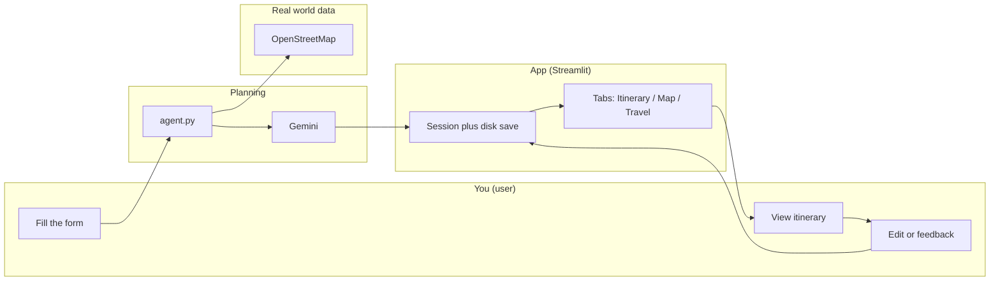


---


## 3. Big picture flowchart

The whole system in one diagram:

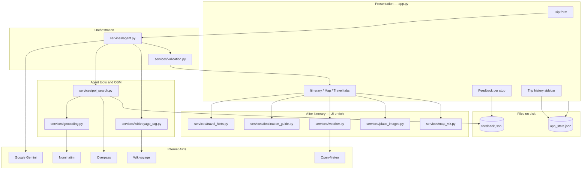


**Layers in plain words:**

- **UI** — Shows the page, buttons, and saves session state.
- **Agent** — Gemini plus tools. This is where itinerary JSON is created or updated.
- **Post** — After the plan exists: weather, photos, map. This runs when the page renders, not inside the agent loop.

---


## 4. Code map — which file does what

```
Travel_Planner/
├── app.py              ← Entry: Trip Planner + st.navigation pages
├── config.py           ← .env, paths (incl. portal + demo bookings)
├── info.md             ← This document (also rendered at /dev)
├── using.md            ← End-user guide (users vs admin)
├── pages/              ← Streamlit multipage routes (bookings, support, admin, …)
├── data/
│   ├── app_state.json
│   ├── feedback.jsonl
│   ├── demo_bookings.json          ← Static mock flights/trains/buses
│   ├── customer_portal_state.json  ← Refunds, tickets, user package bookings (gitignored)
│   └── customer_portal_state.json.example
├── tests/              ← e.g. test_refund_eligibility, test_terms_rag
└── services/           ← Planner + portal logic (see tables below)
```


### `app.py` — main functions (good reading order)


| Function                                                     | Job                                                           |
| ------------------------------------------------------------ | ------------------------------------------------------------- |
| `main()`                                                     | Page setup, form, tabs, flush disk save at end if dirty       |
| `_init_session()`                                            | First visit: load `app_state.json` into `st.session_state`    |
| `_mark_dirty()` / `_flush_persist()` / `_persist_if_dirty()` | Write session to disk only when something changed             |
| `_run_generation(mode)`                                      | Validate inputs, call `run_agent`, update session and history |
| `_render_itinerary()`                                        | Days, feedback buttons, nearby swap                           |
| `_render_route_map()`                                        | PyDeck map                                                    |
| `_render_beginner_travel_guide()`                            | Travel & stays tab content                                    |


### `services/` — at a glance


| File                                                      | Short role                                  |
| --------------------------------------------------------- | ------------------------------------------- |
| `agent.py`                                                | Gemini, fast path, tool loop, trace         |
| `poi_search.py`                                           | `search_pois` — Overpass, ranking, feedback |
| `geocoding.py`                                            | City name to lat/lon (Nominatim)            |
| `validation.py`                                           | Form checks, JSON checks, poi_id checks     |
| `refine_itinerary.py`                                     | Small edits without LLM, add a place        |
| `feedback.py`                                             | JSONL votes to boost map                    |
| `persistence.py`                                          | Read and write `app_state.json`             |
| `trip_history.py`                                         | Sidebar saved trips                         |
| `travel_hints.py`                                         | Airports, budget hotels, tips               |
| `destination_guide.py`                                    | City blurb, seasons                         |
| `weather.py`                                              | Open-Meteo                                  |
| `map_viz.py`                                              | PyDeck route                                |
| `nearby_pois.py`                                          | Suggest places close to a stop              |
| `place_images.py`                                         | Images for stops and hints                  |
| `wikivoyage_rag.py`                                       | Optional guide chunks                       |
| `http_client.py`                                          | HTTP plus User-Agent                        |
| `retry_utils.py`                                          | Gemini retries                              |
| `ui_components.py` / `ui_animations.py` / `trace_view.py` | UI helpers                                  |


### Portal and admin (`pages/` + `services/`)


| File / folder                                  | Short role                                                      |
| ---------------------------------------------- | --------------------------------------------------------------- |
| `pages/bookings_refunds.py`                    | Book package, my bookings, refund tracking                      |
| `pages/refund_assistant.py`                    | Eligibility checker + chat for one booking                      |
| `pages/support.py`                             | FAQ, support bot, tickets                                       |
| `pages/terms_policies.py`                      | Full terms + policy comparison table                            |
| `pages/account_status.py`                      | Restrictions and appeals                                        |
| `pages/admin_demo.py`                          | Admin page shell → interactive console                          |
| `pages/dev.py`                                 | Renders this `info.md` in the browser                           |
| `customer_portal_store.py`                     | Load/save `customer_portal_state.json`, tickets, refunds, audit |
| `bookings.py`                                  | Merge catalog + user-created package bookings                   |
| `travel_packages.py` / `package_booking_ui.py` | Package catalog, pricing, booking UI                            |
| `refund_policy_config.py`                      | Policy definitions and workflow status names                    |
| `refund_eligibility.py`                        | **Single source of truth** for refund decisions                 |
| `terms_content.py` / `terms_rag.py`            | Terms text + lightweight retrieval for bots                     |
| `support_faq.py`                               | Support bot answers (RAG + live account/booking lookups)        |
| `policy_bot_ui.py`                             | Shared chat UI; Trip Planner floating policy assistant          |
| `portal_ui.py`                                 | Portal layout, hero, sidebar account dock, status pills         |
| `role_dashboard.py`                            | Per-page context strips (user vs admin preview)                 |
| `admin_console.py`                             | Tabbed admin: refunds, tickets, accounts, audit                 |
| `demo_dashboard.py`                            | Sidebar **User / Admin** switch and navigation                  |
| `demo_users.py`                                | Fake user profiles and account statuses                         |
| `portal_display.py` / `ui_copy.py`             | Shared refund/ticket copy; UI text polish layer                 |


---


## 5. Streamlit app flow (`app.py`)

Every time you refresh or click a button, Streamlit **runs the whole script again**. That is why state lives in `st.session_state` and on disk.

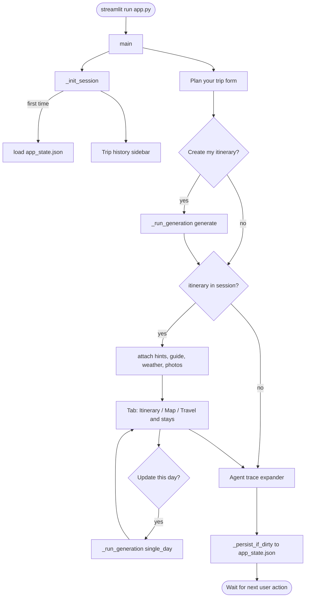


**Important design choice:** The itinerary and map render **outside** the Create button handler. If they were inside, changing a map filter could wipe the whole plan (capstone requirement).

### Session vs disk

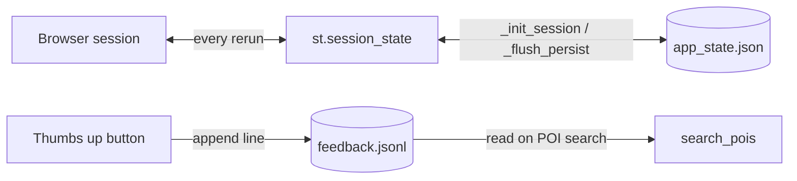


---


## 6. Agent flow — how the itinerary is built

Entry point: `services/agent.py` → `run_agent(...)`.

### 6.1 Decision tree — which path runs?

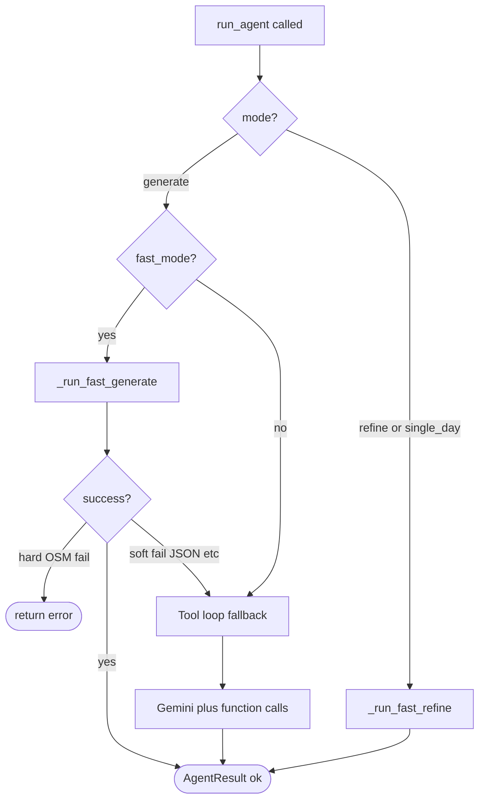


| Mode         | How the UI triggers it                             |
| ------------ | -------------------------------------------------- |
| `generate`   | **Create my itinerary**                            |
| `single_day` | **Update this day** plus your change text          |
| `refine`     | Supported in code; full-trip refine UI is optional |


Default: `fast_mode=True` (from `app.py` → `_agent_settings()`).

### 6.2 Fast generate (default path) — step flowchart

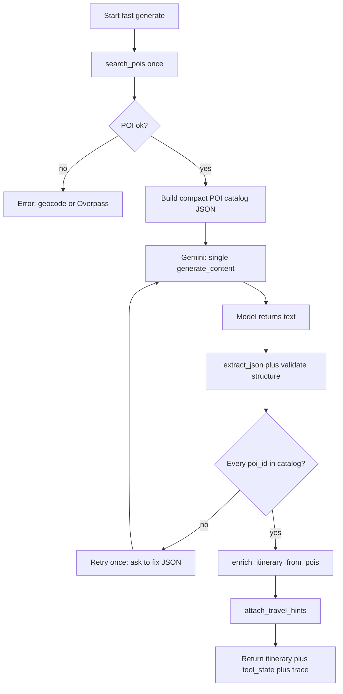


**What Gemini gets:** trip days, pace, interests, constraints, and an **allowed POI list only** (id, name, category).

**What Gemini returns:** one JSON object with `days[]` and `morning` / `afternoon` / `evening` arrays.

### 6.3 Tool loop (fallback) — flowchart

When the fast path fails (JSON or tools) or fast mode is off:

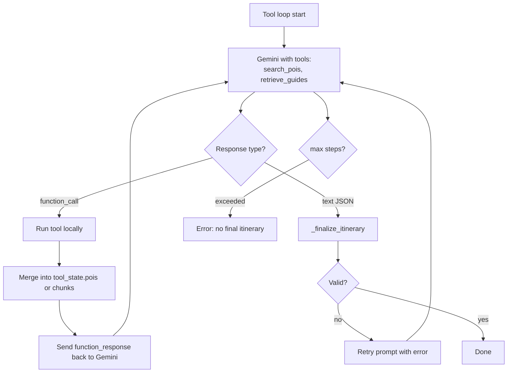


Tools are declared in `agent.py` → `_gemini_tools()`.

### 6.4 Sequence diagram — Create my itinerary

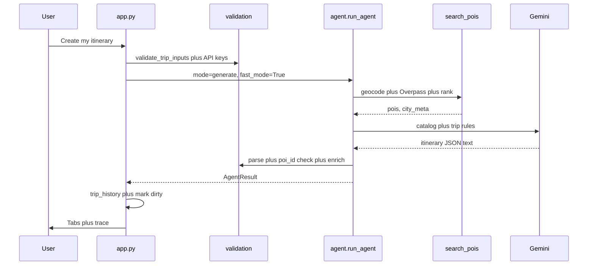


### 6.5 Fast refine / single day — flowchart

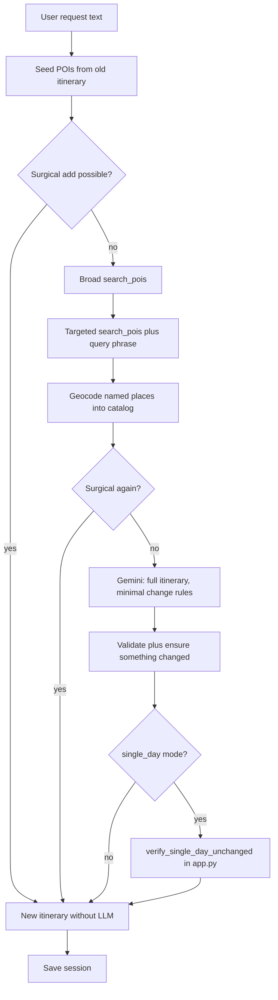


---


## 7. POI search flow (OpenStreetMap)

Function: `search_pois(city, interests, user_agent, limit, query_text?, fast?)`

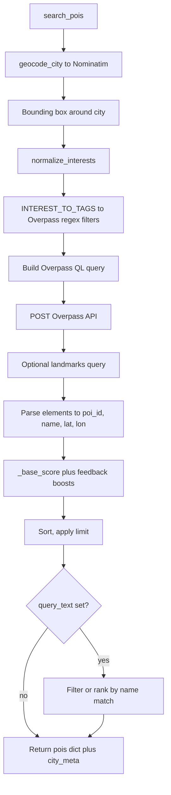


**Interest examples (what you type → what OSM searches):**


| User interest | OSM idea                |
| ------------- | ----------------------- |
| museums       | `tourism=museum         |
| food          | `amenity=restaurant     |
| outdoors      | parks, beaches, peaks   |
| history       | `historic`, attractions |


If nothing matches well, the app uses a default mix: museums, food, outdoors.

**poi_id format:** `osm_node_123`, `osm_way_456`, and so on. Validation checks against this pattern.

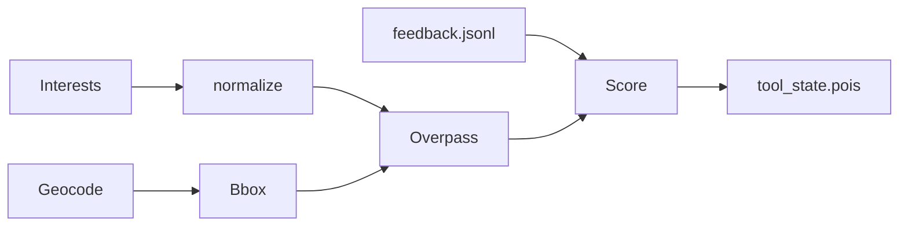


---


## 8. Validation flow

Validation happens in two places.

**A) Form (before the agent runs)** — `validate_trip_inputs`

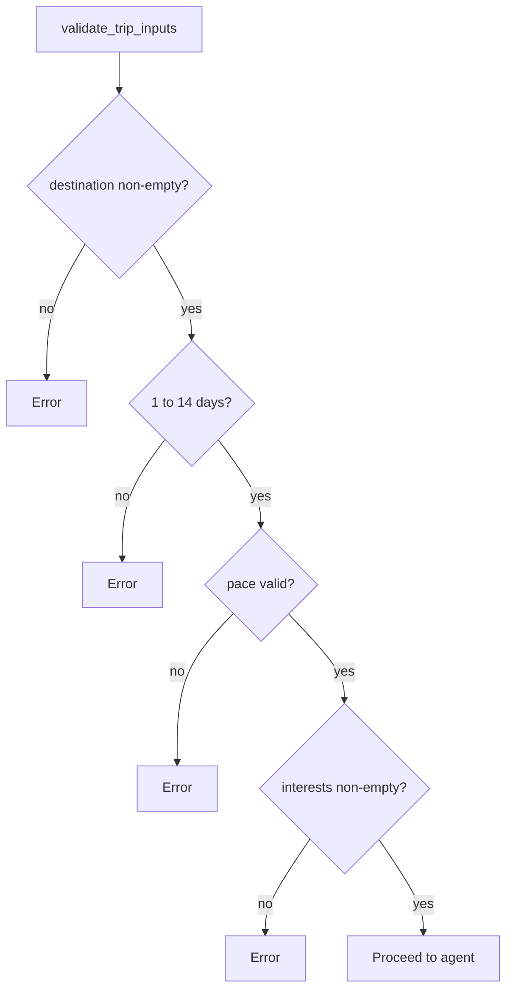


**B) Model output (after the agent)** — `_finalize_itinerary`

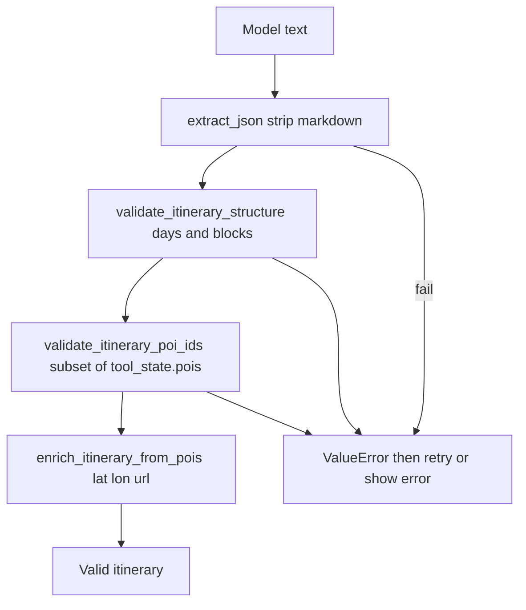


---


## 9. Single-day update and nearby swap


### Single day (uses AI)

You pick a day number and type **What should change?** → `_run_generation("single_day",...)`.

Same refine pipeline as other updates. **Extra rule:** all other days must stay the same (`verify_single_day_unchanged`).

### Nearby swap (no AI)

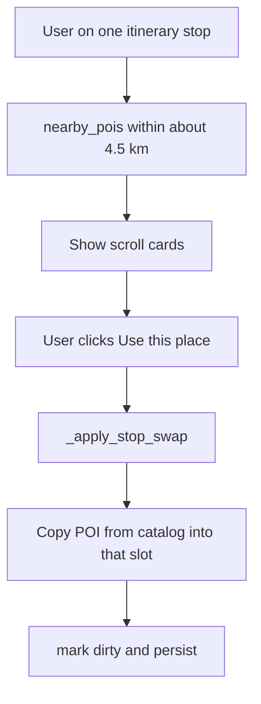


Gemini is **not** called here. One catalog entry replaces the stop.

---


## 10. Feedback loop

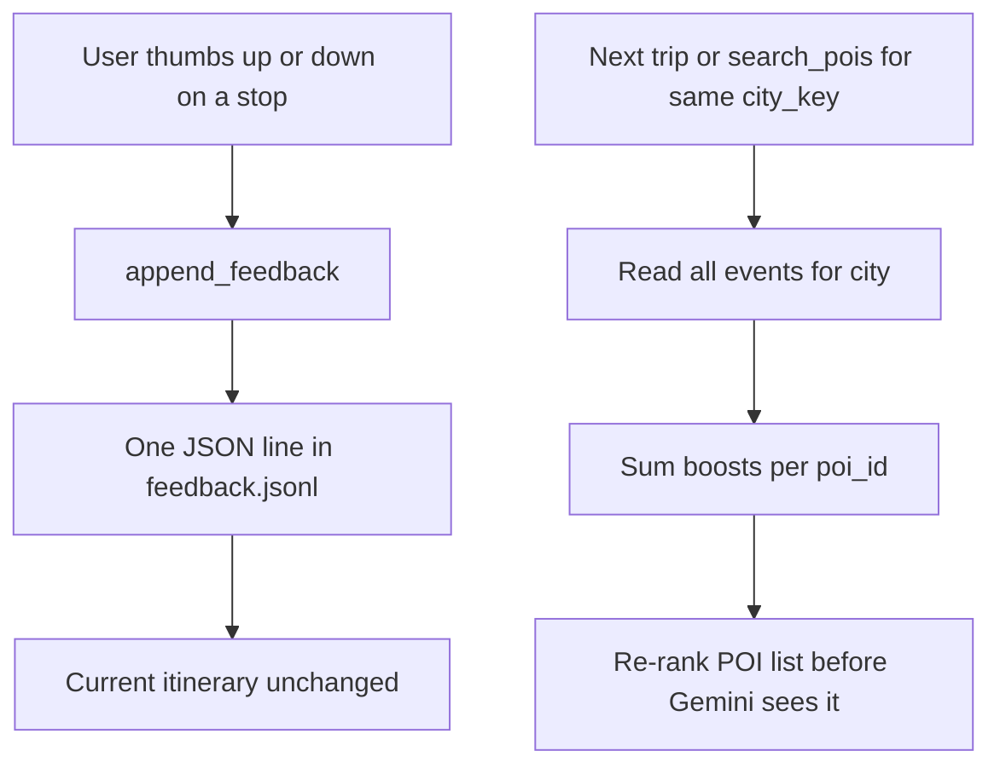


| Vote        | Score change (per event) |
| ----------- | ------------------------ |
| Thumbs up   | +0.25                    |
| Thumbs down | −0.35                    |


Scoped by `city_key` from geocode metadata. The same POI id in two cities is counted separately.

---


## 11. Travel tab extras (weather, guide, hotels)

After the itinerary exists, each page render adds extras (with cache keys to avoid repeat work):

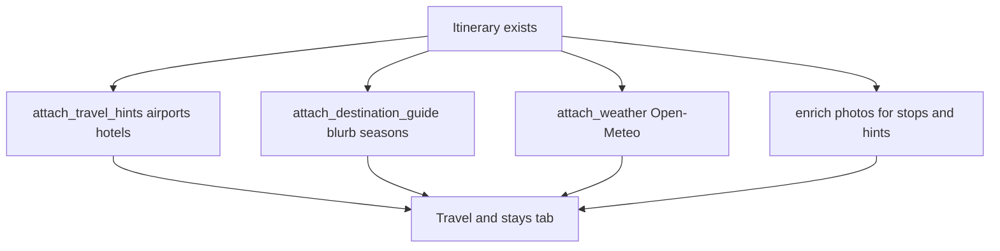


| Cache key in tool_state | When it refreshes   |
| ----------------------- | ------------------- |
| `_hints_key`            | `v5                 |
| `_photos_key`           | hints key changes   |
| `_guide_key`            | destination changes |
| `_weather_key`          | `dest               |


**Map tab** is separate: `map_viz.build_deck` — green start, purple destination, pink airport, orange visit path.

---


## 12. Optional Wikivoyage RAG

Off by default (`ENABLE_WIKIVOYAGE_RAG` in `.env`). Fast agent mode does not use RAG.

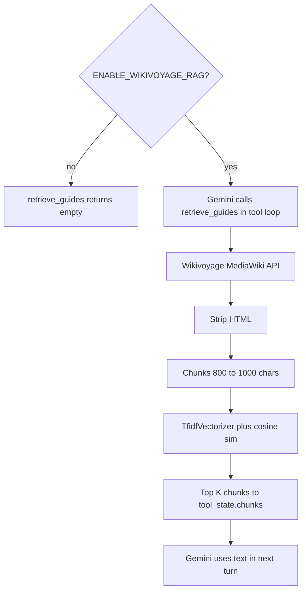


---


## 13. Data files and memory


### `app_state.json` — what is stored


| Key                                  | Meaning                                 |
| ------------------------------------ | --------------------------------------- |
| `itinerary`                          | Current plan JSON                       |
| `tool_state`                         | POI catalog, hints, weather, cache keys |
| `agent_trace`                        | Debug timeline of the last agent run    |
| `form_destination`, `form_origin`, … | Form default values                     |
| `trip_history[]`                     | Snapshots of past trips                 |


### `tool_state` — for planner and UI


| Key                                            | Meaning                          |
| ---------------------------------------------- | -------------------------------- |
| `pois`                                         | All known places by id           |
| `city_meta`                                    | Includes `city_key` for feedback |
| `travel_hints`, `destination_guide`, `weather` | Travel tab                       |
| `chunks`                                       | Wikivoyage RAG (if any)          |


### User journey on disk

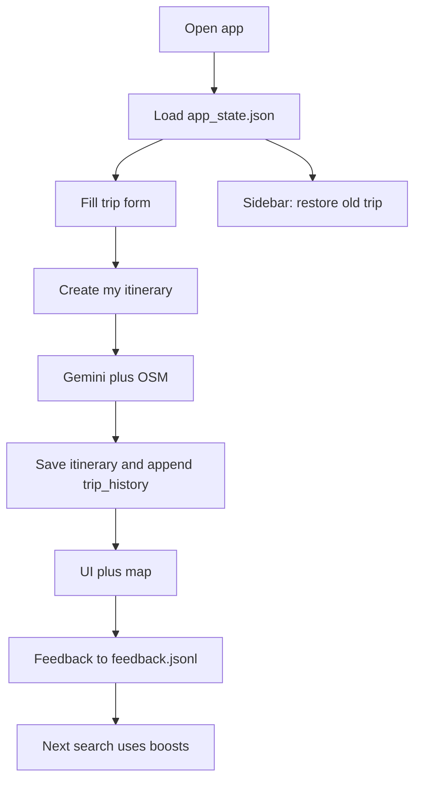


### Portal persistence (`customer_portal_state.json`)

Written by `services/customer_portal_store.py`. Typical keys:


| Key                 | Meaning                                                |
| ------------------- | ------------------------------------------------------ |
| `current_user_id`   | Last selected sidebar account                          |
| `refund_requests[]` | Submitted refunds with workflow + eligibility snapshot |
| `support_tickets[]` | Tickets, status, message thread                        |
| `user_bookings[]`   | Package bookings created in-app (`BK-PKG-…`)           |
| `account_overrides` | Admin-set account status per user                      |
| `account_appeals[]` | User appeals                                           |
| `audit_log[]`       | Admin actions (refunds, tickets, accounts)             |


Catalog bookings (`BK-FLT-…`, etc.) live in `demo_bookings.json` only; they are not duplicated in portal state unless you extend the app.

Bootstrap sample refund/ticket/appeal rows run once when state is first created (`bootstrap_demo_data`).

---


## 14. Itinerary JSON shape

```json
{
 "destination": "Goa",
 "days": [
 {
 "day": 1,
 "morning": [
 {
 "poi_id": "osm_node_12345",
 "name": "Place name",
 "why": "One short sentence in English"
 }
 ],
 "afternoon": [],
 "evening": []
 }
 ]
}
```

Each day has **three fixed blocks**: `morning`, `afternoon`, `evening`. Empty lists are allowed.

After enrichment you may also see: `lat`, `lon`, `category`, `url`, and sometimes `image_url`.

---


## 15. Config and APIs


### Setup

1. `python -m venv trip-planner-env` → activate → `pip install -r requirements.txt`
2. Copy `.env.example` → `.env`
3. `streamlit run app.py`


### Environment


| Variable                | Required | Purpose                   |
| ----------------------- | -------- | ------------------------- |
| `GEMINI_API_KEY`        | Yes      | Gemini                    |
| `OSM_CONTACT_EMAIL`     | Yes      | OSM User-Agent (policy)   |
| `ENABLE_WIKIVOYAGE_RAG` | No       | `true` = RAG in tool loop |


### External services


| Service              | API key?        | Use              |
| -------------------- | --------------- | ---------------- |
| Google Gemini        | Yes             | Itinerary JSON   |
| Nominatim / Overpass | No (email only) | Geocode and POIs |
| Wikivoyage           | No              | Optional RAG     |
| Open-Meteo           | No              | Weather          |


### Important `config.py` numbers


| Setting                           | Value                                    |
| --------------------------------- | ---------------------------------------- |
| `DEFAULT_MODEL`                   | `gemini-3.5-flash-lite` (plus fallbacks) |
| `FAST_POI_LIMIT`                  | 45                                       |
| `UPVOTE_BOOST` / `DOWNVOTE_BOOST` | 0.25 / −0.35                             |
| `DEMO_BOOKINGS_PATH`              | `data/demo_bookings.json`                |
| `CUSTOMER_PORTAL_STATE_PATH`      | `data/customer_portal_state.json`        |


---


## 16. Errors and retries

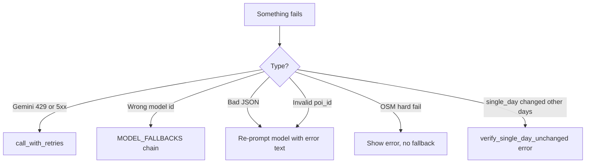


The user sees `st.error(last_error)`. Sometimes **Export & advanced** shows raw model output.

**Agent trace** (expander at the bottom of the page): each step — tool name, milliseconds, detail — for debugging.

---


## 17. Multi-page navigation and roles

`app.py` uses `st.navigation()` with page groups that depend on **Dashboard** mode (`services/demo_dashboard.py`):

- **User** — Trip planning + **Bookings & support** (no admin page in the main group).
- **Admin** — **Admin dashboard** first; customer pages remain available for preview.

Each portal page calls `portal_page_setup()` (`services/portal_ui.py`), which:

1. Injects portal styles and sidebar links.
2. Renders a page hero and a short **context strip** (`role_dashboard.py`).
3. Shows the **account dock** at the bottom of the sidebar (switch fake users).

**Admin preview:** In admin mode, refund **submit** from the customer UI is blocked; processing happens in the admin console. Package booking still attributes to the **sidebar-selected account**.

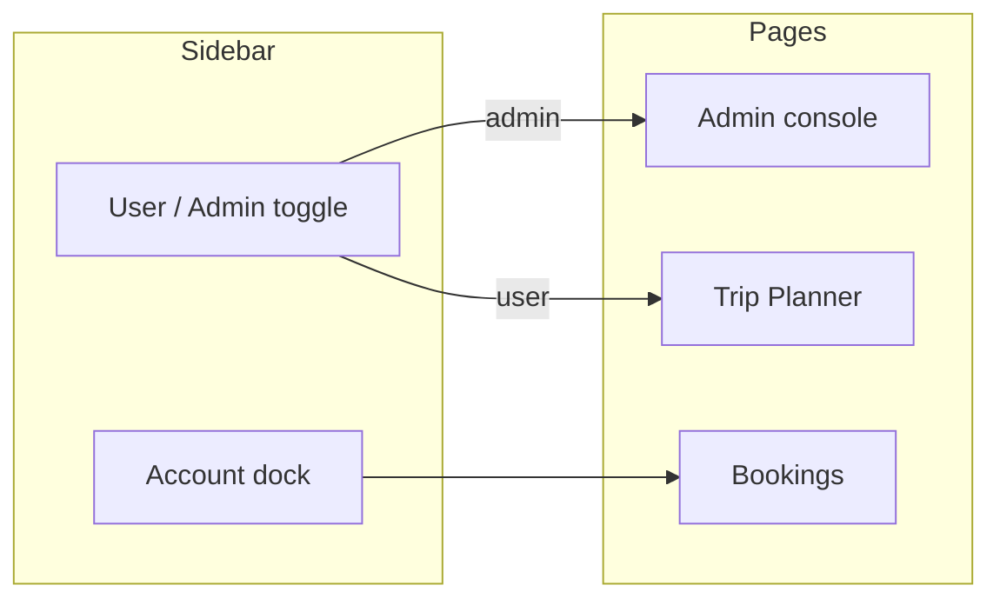


---


## 18. Customer portal architecture

High-level flow:

```mermaid
flowchart TB
 UI[pages/*.py] --> PU[portal_ui.py]
 PU --> RDS[role_dashboard.py]
 UI --> BK[bookings.py]
 BK --> Cat[(demo_bookings.json)]
 BK --> Store[(customer_portal_state.json)]
 UI --> RE[refund_eligibility.py]
 RE --> Pol[refund_policy_config.py]
 Store --> CPS[customer_portal_store.py]
```


**Bookings list:** `list_bookings_for_user(user_id)` merges catalog rows for that user with `user_bookings` from portal state, sorted by **booking time** (`created_at` for packages, catalog order for seeds).

**Refunds:** Submitting from **My Bookings** runs `evaluate_refund_request()` and, if allowed, appends to `refund_requests` with workflow status and amounts. **Refund request tracking** shows workflow status, eligibility, linked booking details, and timeline.

---


## 19. Refund rule engine

Entry: `evaluate_refund_request(booking, user_id, account_status, existing_refund, reason)`.

Checks (in order, simplified):

1. Policy exists for `booking.policy_id`.
2. Booking belongs to `user_id`.
3. No duplicate refund for same `booking_id`.
4. Booking status (not already refunded / completed / invalid).
5. Account flags (blacklist → manual review; under review / restricted → manual).
6. Departure window vs `policy.min_hours_before_departure`.
7. Refundability (`none` / `partial` / full) and fee math via `calculate_refund_amounts`.

Outputs: `RefundEvaluation` (eligibility label, fees, `workflow_status`, `explanation_detail`, procedure steps).

**Tests:** `python -m tests.test_refund_eligibility`

Admin workflow advance: `advance_demo_workflow()` steps through `REFUND_WORKFLOW_STATUSES` in `refund_policy_config.py` (internal names may include “(Demo)” — display layer strips that via `ui_copy.polish_ui_copy`).

---


## 20. Travel package booking


| Piece                               | Role                                                                      |
| ----------------------------------- | ------------------------------------------------------------------------- |
| `travel_packages.py`                | Package definitions, fare tiers, `estimate_package_breakdown()`           |
| `package_booking_ui.py`             | **Book package** tab: live estimate, confirm → `create_package_booking()` |
| `bookings.create_package_booking()` | Writes `BK-PKG-*` record to `user_bookings`                               |


**Trip Planner → portal:** **Book as travel package** sets session prefill (`PACKAGE_BOOKING_PREFILL_KEY`) and navigates to `/bookings` **Book package** tab.

After confirm, UI shows **Package confirmed** (disabled button) until form fields change; success flash uses session keys `pkg_booking_confirmed_flash` / `pkg_booking_confirmed_snapshot`.

---


## 21. Support, tickets, and policy bots


| Surface                                           | Engine                                                                   |
| ------------------------------------------------- | ------------------------------------------------------------------------ |
| Help & Support → **Support bot**                  | `support_faq.answer_support_query()`                                     |
| Trip Planner **policy assistant** (FAB / sidebar) | Same engine via `policy_bot_ui.render_policy_bot_chat()`                 |
| Terms page                                        | Static `terms_content.py`; bots use `terms_rag.retrieve_policy_chunks()` |


Support bot may combine **live data** (account status, latest refund, booking lookup) with **terms excerpts**. Low confidence suggests opening a ticket.

**Tickets:** `create_support_ticket()`, user replies, admin updates via `admin_update_ticket()` (status + support message on thread). Admin views **why the ticket was raised** (category, subject, first user message) in `portal_display.ticket_why_raised_markdown()`.

---


## 22. Admin console

Rendered from `pages/admin_demo.py` → `admin_console.render_admin_console()`.


| Tab       | Actions                                                                                     |
| --------- | ------------------------------------------------------------------------------------------- |
| Overview  | Queues needing attention                                                                    |
| Refunds   | Filter, advance workflow, approve/reject/complete; shows customer reason + booking snapshot |
| Tickets   | Status, reply, approve/resolve                                                              |
| Accounts  | Set account status overrides                                                                |
| Audit log | Recent back-office events                                                                   |


**Unlock:** Admin page passphrase is checked in code as `demo_admin` (training only — not production security). Switching sidebar to **Admin** also sets `admin_unlocked` for the session.

Embedded ticket tools also appear on **Help & Support** when in admin mode (`render_admin_tickets_embedded`).

---


## 23. Glossary


| Term                | Meaning                                                           |
| ------------------- | ----------------------------------------------------------------- |
| **POI**             | Point of interest — museum, restaurant, park, and so on           |
| **poi_id**          | OSM-based stable id string in the catalog                         |
| **tool_state**      | Shared memory for agent and UI (especially `pois`)                |
| **Fast mode**       | Fewer steps: direct OSM plus one Gemini call (default)            |
| **Tool loop**       | Gemini calls `search_pois` / `retrieve_guides` itself             |
| **RAG**             | Retrieval: Wikivoyage text chunks give the model extra context    |
| **city_key**        | Feedback scope — usually a normalized city name                   |
| **Surgical refine** | Small code-only edit without the LLM                              |
| **Session rerun**   | Streamlit runs the script again on every interaction              |
| **Portal state**    | `customer_portal_state.json` — refunds, tickets, package bookings |
| **Catalog booking** | Row in `demo_bookings.json` (e.g. `BK-FLT-1001`)                  |
| **Package booking** | User-created row in `user_bookings` (`BK-PKG-…`)                  |
| **Rule engine**     | `refund_eligibility.py` — must match UI and bot outcomes          |
| **Terms RAG**       | `terms_rag.py` — scores chunks from terms + FAQ for bot replies   |


---


## Credits

OpenStreetMap contributors, Wikivoyage, Google Gemini API, Open-Meteo.

---


## Document updates


| When            | What                                                                                    |
| --------------- | --------------------------------------------------------------------------------------- |
| Initial         | Full architecture and flowcharts                                                        |
| Rewrite         | English-only, simple language; persistence and UI aligned with current `app.py`         |
| Portal capstone | Customer portal, package booking, refund engine, admin console, policy bots, data paths |


*When you add features, update the matching section and flowchart in this file.*