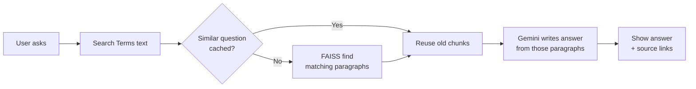
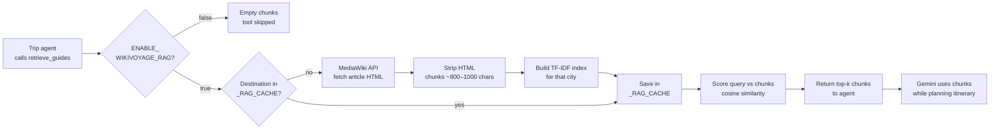

## 1) Policy / Terms RAG (Support bot, Document Assistant)

Support bot (policy path), Document Assistant chat, and Trip policy FAB share **Terms FAISS + optional semantic cache + Gemini**. Booking/refund shortcuts in Support use live portal data without FAISS.

## 2) Wikivoyage TF-IDF RAG (`wikivoyage_rag.py`)

Optional trip agent tool only (`retrieve_guides`). **sklearn TF-IDF + cosine** — not FAISS. Off unless `ENABLE_WIKIVOYAGE_RAG=true`.

